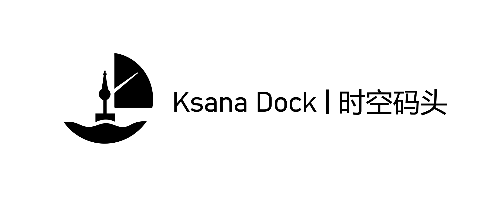

# Microverse

<div align="center">

[](https://www.ksanadock.com)

**KsanaDock | Time Space Dock**

Easily DIY your own version of Microverse and generate unique AI worlds and characters.

[Visit www.ksanadock.com](https://www.ksanadock.com)

</div>

---

A god-simulation sandbox game: a multi-agent AI social simulation built with Godot 4. In this virtual world, AI characters have their own thoughts and memories, socialize and complete tasks on their own, and develop complex social relationships through ongoing interaction.

## 📸 Preview

<div align="center">


*AI characters interacting in the office scene*

</div>

## 🌟 Highlights

- **Sandbox AI society**: Similar to Stanford's AI Town, AI characters live and interact autonomously in an open world
- **Multi-agent ecosystem**: Multiple AI characters can engage in complex social interactions in the same scene at once
- **Intelligent dialogue system**: Natural conversations powered by large language models, with support for multiple API providers
- **Persistent memory system**: AI characters have long-term memory, remembering past conversations and events to form a continuous life experience
- **Autonomous task management**: AI characters accept, carry out, and manage their own tasks, mirroring real working life
- **Environmental awareness**: AI characters perceive their surroundings and the state of other characters, and react accordingly
- **Multiple AI services**: Supports OpenAI, Claude, Gemini, DeepSeek, Doubao, Kimi, SiliconFlow, Ollama, and any OpenAI-compatible service

## 🎮 Sandbox Features

### 🤖 AI Character Ecosystem
- 8 preset AI characters, each with a unique personality, backstory, and behavior patterns
- Characters move, explore, and interact freely in the virtual world
- Character state management, mood changes, and autonomous decision-making
- AI characters react realistically to their environment and social situations

### 💬 Natural Social System
- Natural-language conversations powered by large language models, with multi-turn exchanges
- Dynamic speech bubble UI showing conversations between characters in real time
- Complete conversation history recording
- Multiple conversations can run at the same time

### 🧠 Memory & Learning
- Persistent long-term memory storage
- AI characters learn from and adapt to changes in their environment
- Structured memory storage and retrieval
- Personalized behavior that develops from memories

### 📋 Autonomous Task Ecosystem
- Automatic task creation and real-time tracking
- Priority-based ("desire level") task management
- Dynamic monitoring of task completion
- Characters seek each other out to collaborate on tasks

## 🛠️ Tech Stack

- **Game engine**: Godot 4.3+
- **Language**: GDScript
- **AI integration**: REST API calls
- **Data storage**: Local JSON files
- **UI framework**: Godot's built-in UI system

## 📋 System Requirements

### Development Environment
- Godot 4.3 or later

### Supported Platforms
- **Windows**: Windows 10/11 (64-bit)
- **macOS**: macOS 10.15+ (Intel/Apple Silicon)
- **Linux**: Ubuntu 18.04+, Fedora 32+, Arch Linux, and other major distributions
- **Android**: Android 6.0+ (API Level 23+)

### Hardware Requirements
- **Minimum**: 4GB RAM, 1GB free storage
- **Recommended**: 8GB RAM, 2GB free storage
- **Network**: A stable internet connection (for AI API calls)

### Notes
- Android requires additional platform-specific configuration
- All platforms need a valid AI service API key for the dialogue features to work (except local Ollama)

## 🚀 Quick Start

### 1. Clone the project
```bash
git clone https://github.com/KsanaDock/Microverse.git
cd Microverse
```

### 2. Open the project
1. Launch the Godot editor
2. Click "Import"
3. Select the `project.godot` file in the project root
4. Click "Import & Edit"

### 3. Configure the API
1. Run the game (F5)
2. Press ESC to open the settings screen
3. In the "API Settings" tab, choose your AI service provider, model, and API key, then click "Save"
4. Supported providers:
   - OpenAI
   - Anthropic Claude
   - Google Gemini
   - DeepSeek
   - Doubao (ByteDance)
   - Kimi (Moonshot AI)
   - SiliconFlow
   - Ollama (local deployment, no API key required)
   - Any OpenAI-compatible API

Each character can also use its own AI settings: select the character in the God UI and open its "AI Settings" tab.

### 4. Play
1. The game opens in the office scene
2. Click a character to select it, then move it with WASD or the arrow keys
3. Press T to start a conversation with a nearby AI character
4. Press L to end the conversation
5. Press ` to open the console

## 🎯 Usage

### Controls
- **Move**: WASD or arrow keys
- **Sit / stand**: Enter (or click a chair to walk to it and sit down)
- **Start conversation**: T
- **End conversation**: L
- **Settings**: ESC
- **Toggle God UI**: F1
- **Save / load**: F3
- **Reset camera view**: Space
- **Console**: ` (backtick)

### AI Characters
- **Stephen**: Boss of SleepySheep Company
- **Tom**: Senior executive secretary to the boss
- **Lea**: Receptionist
- **Alice**: Frontend engineer and UI designer
- **Grace**: HR
- **Jack**: Backend engineer
- **Joe**: QA test engineer
- **Monica**: Product manager

The full personas are defined in `script/CharacterPersonality.gd`.

### Advanced Features
- **God tools**: Implant memories, set illnesses, change money, and set relationships between characters
- **Task management**: Assign and manage tasks for AI characters
- **Story background**: Edit each map's background story and social rules
- **Save system**: Save and load the game state

## 🔧 Development Guide

### Project Structure
```
Microverse/
├── asset/          # Game assets (sprites, fonts, UI themes, etc.)
├── scene/          # Godot scene files
│   ├── characters/ # Character scenes
│   ├── maps/       # Map scenes
│   ├── prefab/     # Reusable objects (chairs, desks, etc.)
│   └── ui/         # UI scenes
└── script/         # GDScript source code
    ├── ai/         # AI-related scripts (agent, dialog, memory, background story)
    └── ui/         # UI-related scripts
```

### Core Systems
- **AIAgent**: Core AI character decision logic
- **APIManager / APIConfig**: AI API calls and provider configuration
- **DialogManager / DialogService**: Conversation management
- **MemoryManager**: Memory system
- **CharacterManager**: Character selection and control
- **BackgroundStoryManager**: Story backgrounds and social rules
- **GameSaveManager**: Saving and loading

### Extending
- Add new AI characters
- Create new maps
- Integrate new AI service providers
- Extend the dialogue features

## 🎮 Coming Soon to Steam

<div align="center">


**Microverse In Box is coming to Steam!**

[](https://store.steampowered.com/app/3902630/Microverse_In_Box/)

[🎯 **Add to Steam Wishlist**](https://store.steampowered.com/app/3902630/Microverse_In_Box/) | [📖 **View Steam Page**](https://store.steampowered.com/app/3902630/Microverse_In_Box/)

---

**📝 About this open-source project**: This repository contains the initial June 2025 demo of *Microverse In Box*, open-sourced for developers and enthusiasts to learn from and reference. The full game will be released on Steam with more features, optimizations, and content.

</div>

## 🤝 Contributing

Contributions are welcome! See the [Contributing Guide](CONTRIBUTING.md) for details, or follow these steps:

1. Fork the project
2. Create a feature branch (`git checkout -b feature/AmazingFeature`)
3. Commit your changes (`git commit -m 'Add some AmazingFeature'`)
4. Push to the branch (`git push origin feature/AmazingFeature`)
5. Open a Pull Request

## 📝 License

This project is licensed under the MIT License - see the [LICENSE](LICENSE) file for details.

## 🙏 Acknowledgments

- The Godot Engine team
- The AI service providers
- Contributors from the open-source community
- Art assets: [LimeZu](https://limezu.itch.io/) - thanks to this excellent artist for the beautiful game assets
- Server sponsored by DartNode

[](https://dartnode.com "Powered by DartNode - Free VPS for Open Source")

## 📞 Contact

<div align="center">



</div>

For questions or suggestions, reach us through:

- Issues: [GitHub Issues](https://github.com/KsanaDock/Microverse/issues)
- Official website: [KsanaDock](https://www.ksanadock.com)

## 🌐 Follow Us

<div align="center">

### Follow our latest updates on social media

<table>
<tr>
<td align="center" width="200">
<a href="https://www.xiaohongshu.com/user/profile/653c5f81000000000301f274">

<br/>
<strong>Xiaohongshu</strong>
<br/>
<sub>Creative Sharing & Community</sub>
</a>
</td>
<td align="center" width="200">
<a href="https://space.bilibili.com/336052319">

<br/>
<strong>Bilibili</strong>
<br/>
<sub>Video Content</sub>
</a>
</td>
<td align="center" width="200">
<a href="https://github.com/KsanaDock">

<br/>
<strong>GitHub</strong>
<br/>
<sub>Source Code & Updates</sub>
</a>
</td>
</tr>
<tr>
<td align="center" width="200">
<a href="https://x.com/KsanaDock">

<br/>
<strong>X (Twitter)</strong>
<br/>
<sub>Latest News & Discussion</sub>
</a>
</td>
<td align="center" width="200">
<a href="https://store.steampowered.com/app/3902630/Microverse_In_Box/">

<br/>
<strong>Steam</strong>
<br/>
<sub>Game Releases & Updates</sub>
</a>
</td>
<td align="center" width="200">
<a href="https://www.youtube.com/@KsanaDock">

<br/>
<strong>YouTube</strong>
<br/>
<sub>Demo Videos & Tutorials</sub>
</a>
</td>
</tr>
</table>

</div>

---

## Star History

[](https://www.star-history.com/#KsanaDock/Microverse&type=date&legend=top-left)

**Note**: Using this project requires a valid AI service API key (unless you run a local model with Ollama). Please make sure you comply with each AI service provider's terms and conditions.
